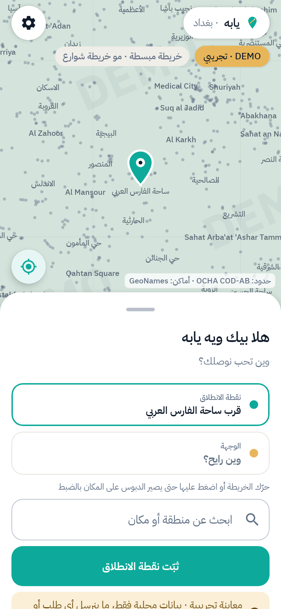
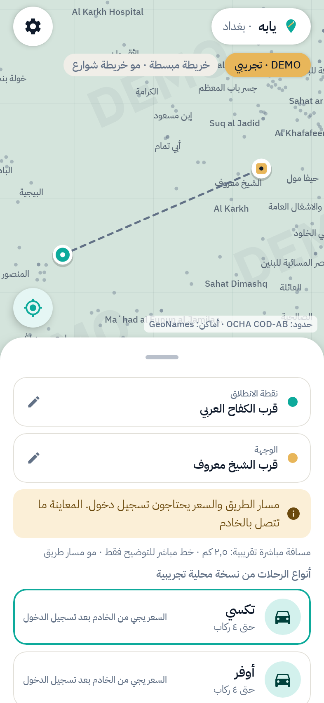

# YABAH | يابه — Native Android (Kotlin · Jetpack Compose)

**مشوارك علينا · Your Journey, Made Easy**

A native Android passenger app (captain mode to follow) for YABAH, built on the existing Supabase backend
(project `Taxi`). Arabic-first (ar-IQ, RTL) with English. Kotlin, Jetpack Compose, Material 3, one activity, one module.

> **Status (12 Nov 2026):** the passenger home, demo, booking flow and trip screens compile, are covered by 55 automated tests
> (including real-gesture UI tests), and are screenshot-verified. **No live backend call has been exercised**: sign-in
> is phone-OTP and the Supabase Phone provider is not enabled yet. Native Mapbox is written but not yet compiled
> (it needs a Mapbox Downloads token). See [docs/TEST_EVIDENCE.md](docs/TEST_EVIDENCE.md) for exactly what is and isn't verified.

| | |
| --- | --- |
|  |  |

## What works

| Area | State |
| --- | --- |
| Passenger home | Map-first screen; **draggable 3-state bottom sheet** (drag, fling, tap the grabber, TalkBack actions); centre pin; tap-to-move; pan/pinch; optional GPS with permission handling; offline place search (GeoNames); local service-area hint mirroring the server rule |
| Demo mode | Fully offline, watermarked **DEMO**; never calls the server, never shows a price, cannot book |
| Live mode (code + contract tests) | Cities from server → road route preview (server LineString only) → **explicit** price request → server quote with expiry countdown (server clock) → cash booking with double-submit guard and timeout reconciliation via `active_trip` |
| Trip | Server-driven status, timeline, captain card, stale-location warning, cancel only where the server allows, one-time rating, polling while visible |
| Auth | Phone + SMS OTP (Google removed by the owner on 11 Nov). **Off by default**; session encrypted with an Android Keystore key |
| Design | Brand tokens (navy #101B2C, ivory #F8F7F3, jade #0DAA9B, gold #E8B65A, slate #627186), IBM Plex Sans Arabic (OFL), original pin-and-road mark, light/dark |

Not built yet: captain journey, history/saved places/notifications/support, push, native Mapbox verification. See
[docs/NEXT_STEPS.md](docs/NEXT_STEPS.md).

## Build & run

Requirements: JDK 17+ (21 tested), Android SDK platform 36. Open in Android Studio, or:

```bash
./gradlew assembleDebug
```

```bash
./gradlew testDebugUnitTest
```

```bash
./gradlew recordRoborazziDebug
```

| Switch | Default | Effect |
| --- | --- | --- |
| `-Pyabah.phoneOtp=true` | `false` | Enables SMS sign-in (only after the Supabase Phone provider is on, see [docs/AUTH.md](docs/AUTH.md)) |
| `MAPBOX_DOWNLOADS_TOKEN=sk…` (gradle property / env, **never commit**) | absent | Compiles the native Mapbox surface (see [docs/MAPBOX.md](docs/MAPBOX.md)) |
| `-Pyabah.supabaseUrl=…`, `-Pyabah.supabasePublishableKey=…` | project `Taxi` | Point at another project. The build refuses `sb_secret_` keys |

## Architecture

```
app/src/main/kotlin/com/yabah/app/
  core/        model · geo (server-identical service-area rule) · net (OkHttp transport, error normalisation)
               auth (GoTrue phone OTP, Keystore session) · location · config · util
  data/        dto (typed edge-function contracts) · places (offline GeoNames search) · repo (Production / Demo)
  map/         MapCameraState · YabahMap (chooses native vs demo) · DemoMapCanvas
  feature/     home · trip · auth · onboarding · settings
  ui/          theme · components (YabahBottomSheet, buttons, badges…) · nav · Localized
app/src/demomap/  NativeMap stub (default)        app/src/mapbox/  native Mapbox surface (token builds)
contracts/   platform-neutral JSON Schemas + semantics (for a future iOS/Flutter client)
docs/        PHASE0_AUDIT · AUTH · MAPBOX · TEST_EVIDENCE · NEXT_STEPS · screenshots
```

Unidirectional state: `ViewModel` + `StateFlow`. Server calls only on explicit state transitions (never from recomposition),
with cancellation of stale work. Lightweight manual DI (`AppContainer`) that tests replace.

## Security

Only the project URL and the **publishable** key ship in the app. No service-role key, no Mapbox secret, no Google secret.
The Mapbox public token is fetched at runtime and accepted only if it is `pk.`. Sessions are AES-GCM encrypted with a
non-exportable Keystore key and excluded from backups. Raw server error text is never shown. Nothing on the live backend
was changed while building this (see [docs/PHASE0_AUDIT.md](docs/PHASE0_AUDIT.md)).

## Licences & data

IBM Plex Sans Arabic: SIL OFL 1.1. Governorate outlines: OCHA / Iraq CSO COD-AB, CC BY 3.0 IGO. Place names: GeoNames,
CC BY 4.0. Attributions are shown on the map and in Settings → Data sources and licences.
